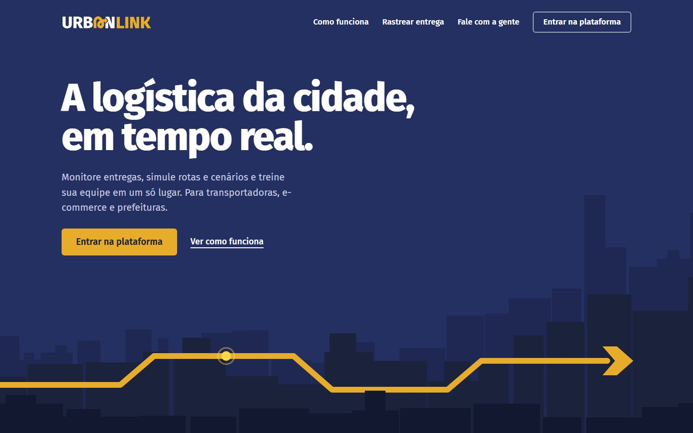
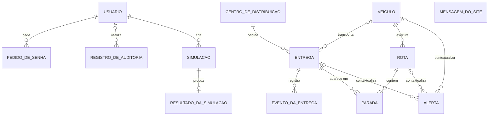

# UrbanLink Flow

Plataforma de gestão e simulação de logística urbana em tempo real, da UrbanLink Systems. Tem um site público, pra apresentar a plataforma, rastrear uma entrega e falar com a equipe, uma API REST com as regras de negócio e um banco PostgreSQL. É o Projeto Integrador do curso técnico de Desenvolvimento de Sistemas (SENAI).



> Projeto acadêmico. A UrbanLink Systems é uma empresa fictícia.

## Site publicado

**Endereço:** _ainda não publicado_

## Objetivo do sistema

Nas cidades inteligentes, a logística urbana precisa ser eficiente e acompanhar o que acontece em tempo real. O UrbanLink Flow existe pra:

- monitorar o fluxo de entregas na cidade, do centro de distribuição até a porta;
- planejar e otimizar rotas, calculando distância, tempo, custo e emissão de CO2;
- simular cenários (trânsito, tamanho da frota, preço do combustível) antes de mudar a operação, e treinar a equipe com eles;
- mostrar indicadores de desempenho e nível de serviço;
- deixar o cliente final acompanhar a própria entrega pelo código de rastreio.

Público: gestores de logística, operadores de transporte, empresas de e-commerce, prefeituras e profissionais de mobilidade urbana.

## Funcionalidades

### Site público

- Página inicial com a apresentação da plataforma.
- **Rastreio de entrega** por código: as quatro etapas (postado, em trânsito, em rota, entregue), com data e cidade de cada uma, imprevistos e previsão de entrega.
- **Fale com a gente**: o formulário grava a mensagem no banco e mostra o número de protocolo.
- **Login** com sessão segura (cookie que o JavaScript da página não lê) e "manter conectado".
- **Recuperar senha** com link de uso único que vence em 30 minutos.
- Política de Privacidade e página de "não encontrado".
- Layout responsivo, do celular ao desktop, e acessível: dá pra usar só com o teclado, e com "reduzir movimento" nenhum efeito anima.

### API (back-end)

- Autenticação com JWT e três perfis com permissões diferentes: administrador, gestor e operador.
- **CRUD** de usuários, veículos, centros de distribuição, entregas, rotas e simulações, com busca, filtros e paginação.
- **Regras de negócio:**
  - distância entre pontos pela fórmula de Haversine;
  - duração com o fator de trânsito e o tempo de cada parada;
  - otimização de rotas por vizinho mais próximo e melhoria 2-opt;
  - capacidade do veículo e transições de estado válidas de entregas e rotas;
  - simulação de cenários com a comparação entre a ordem original e a otimizada;
  - indicadores (entregas no prazo, nível de serviço, uso da frota, custo, CO2) e relatórios;
  - monitoramento demonstrativo em tempo real (Server-Sent Events).
- Documentação interativa (Swagger), verificação de saúde, limite de tentativas e trilha de auditoria.

### Banco de dados

- PostgreSQL com 13 tabelas, criadas por migrations ou pelos scripts SQL de `arquivos-adicionais/sql/`.
- Um **trigger** grava o histórico de cada entrega a cada troca de estado, e uma **sequência** gera o protocolo das mensagens do site.
- Dados de demonstração: 3 usuários, 8 veículos, 24 entregas, 3 rotas e 2 simulações.

### Em andamento

- As telas internas da plataforma (`/app`): monitoramento com mapa, rotas, simulação e cadastros. A API já tem todas as rotas que elas vão usar; hoje, depois do login, a área `/app` só mostra o título.

## Tecnologias

### Site (front-end)

| Camada | Escolha | Por quê |
| --- | --- | --- |
| Base | React 19 + Vite | O enunciado aceita React. Vite é o padrão atual |
| Rotas | React Router | O enunciado cita "tratamento de rotas" no consumo de API |
| Estilo | CSS puro com variáveis + CSS Modules | As cores e medidas da marca ficam todas em `tokens.css` |
| Fonte | Fira Sans (`@fontsource/fira-sans`) | Fonte da marca, servida pelo próprio site |
| Efeitos | GSAP 3 (ScrollTrigger, MotionPath, DrawSVG) + `@gsap/react` | Plugins grátis. O `useGSAP()` desfaz os efeitos ao trocar de página |
| Scroll suave | Lenis, no relógio do GSAP | Fica em sincronia com o ScrollTrigger |
| Mapa | MapLibre GL + `react-map-gl`, dados do OpenFreeMap | Mapa com as cores da marca e sem chave de API |
| Chamadas à API | `fetch` em `src/api` | Uma dependência a menos |
| Qualidade | oxlint | Confere o código rápido |

### API e banco (back-end)

| Camada | Escolha |
| --- | --- |
| Linguagem | Node.js 22 + TypeScript |
| Servidor | Express 5 |
| Banco | PostgreSQL 16 |
| Acesso ao banco | Prisma 7 (schema, migrations e seed) |
| Validação | Zod |
| Segurança | JWT, bcrypt, Helmet, CORS e limite de tentativas |
| Documentação | Swagger (OpenAPI 3.1) |
| Testes | Vitest e Supertest (73 testes) e um smoke test com a API ligada |
| Qualidade | ESLint com typescript-eslint |
| Banco local | Docker Compose |

## Modelagem do banco de dados

13 tabelas, 13 relacionamentos e 12 enums. Os arquivos estão em [`docs/banco-de-dados/`](docs/banco-de-dados/):

| Arquivo | O que tem |
| --- | --- |
| [Modelagem conceitual](docs/banco-de-dados/modelagem-conceitual.md) | Entidades, relacionamentos e cardinalidades |
| [Modelagem lógica](docs/banco-de-dados/modelagem-logica.md) | Cada tabela com colunas, tipos, chaves e enums |
| [DER](docs/banco-de-dados/der.md) | Diagrama Entidade-Relacionamento com todos os atributos |
| [Modelo completo](docs/backend/MODELO_DADOS.md) | Modelo físico, normalização, integridade e dados de demonstração |

O modelo físico são os scripts de [`arquivos-adicionais/sql/`](arquivos-adicionais/sql/) e as migrations de `backend/prisma/migrations/`.



## Como instalar e rodar

O passo a passo completo (banco com Docker, com PostgreSQL instalado ou sem nenhum dos dois, API, site e como usar) está em [`arquivos-adicionais/INSTALACAO.md`](arquivos-adicionais/INSTALACAO.md). O resumo, com Docker:

```bash
cd backend
npm install
cp .env.example .env
docker compose up -d
npm run db:deploy
npm run db:seed
npm run dev
```

Em outro terminal, na raiz:

```bash
npm install
cp .env.exemplo .env.local
npm run dev:api
```

- Site: http://localhost:5173
- API: http://localhost:3333/api
- Documentação da API: http://localhost:3333/api/docs
- Usuário de demonstração: `admin@urbanlink.local`, senha `UrbanLink@2026` (só pra uso local)
- Códigos de rastreio: `ULF-2026-0001` a `ULF-2026-0024`

### Comandos do site

| Comando | O que faz |
| --- | --- |
| `npm run dev:api` | Servidor local falando com a API |
| `npm run dev` | Servidor local com os dados de exemplo, sem a API (se o `.env.development.local` ligar) |
| `npm run build` | Gera o site em `dist/` e roda a trava de dados de exemplo |
| `npm run preview` | Serve o `dist/` pra conferir o build |
| `npm run lint` | Confere o código com o oxlint |

### Comandos da API (dentro de `backend/`)

| Comando | O que faz |
| --- | --- |
| `npm run dev` | API com recarga automática |
| `npm test` | Testes (Vitest e Supertest) |
| `npm run lint` | Confere o código com o ESLint |
| `npm run build` | Compila pra `dist/` |
| `npm run db:deploy` | Aplica as migrations |
| `npm run db:seed` | Apaga e recria os dados de demonstração |
| `npm run test:smoke` | Com a API ligada, testa login, permissões, CRUD e simulação |

### Sem a API: dados de exemplo

Pra ver as telas sem a API, crie um `.env.development.local` com:

```bash
VITE_USAR_EXEMPLOS=true
```

Só o `npm run dev` lê esse arquivo. Com ele, as respostas vêm de `src/api/exemplos/` e a faixa "Dados de exemplo" aparece na tela. O build nunca leva esses dados: o `scripts/sem-exemplos.js` procura os valores de exemplo em `dist/` e faz o build falhar se achar algum.

| Pra ver | Use |
| --- | --- |
| Entrega em rota | código `UL123456789BR` |
| Cada status | `ULEXEMPLOPOSTADO`, `ULEXEMPLOTRANSITO`, `ULEXEMPLOIMPREVISTO`, `ULEXEMPLOENTREGUE` |
| Código que não existe | qualquer outro código |
| Erro de conexão | `ULEXEMPLOERRO`, ou um e-mail começando com `sem-conexao@` |
| Muitas tentativas | e-mail começando com `muitas@` |
| E-mail recusado no contato | e-mail começando com `recusado@` |
| Login | qualquer e-mail com a senha `exemplo123` |
| Link de senha vencido | `/nova-senha/vencido` (o erro aparece ao salvar) |

## Variáveis de ambiente do site

| Variável | Pra quê | Exemplo |
| --- | --- | --- |
| `VITE_API_URL` | Endereço da API | `http://localhost:3333/api` |
| `VITE_USAR_EXEMPLOS` | `true` usa os dados de exemplo no lugar da API (só em dev) | `false` |
| `VITE_LINK_API_DOCS` | Link da documentação da API no rodapé. Vazio, o link não aparece | |
| `VITE_LINK_GITHUB` | Link do código no rodapé. Vazio, o link não aparece | |

As da API estão em `backend/.env.example` e explicadas no [guia de instalação](arquivos-adicionais/INSTALACAO.md#4-api-back-end).

## Estrutura de pastas

```
src/                  o site
  api/                único lugar que chama fetch (cliente.js) e traduz a API pros nomes das telas
    exemplos/         respostas de exemplo (só com VITE_USAR_EXEMPLOS=true)
  components/         Header, Rodape, Botao, Campo, Logo, LogoAnimado, MenuCelular, CarregandoA…
    estrada/          Estrada, Etapa, Placa: a estrada com placas que se repete no site
    cidade/           Skyline, MapaIlustrado, MapaReal, MapaDaEntrega
  pages/              uma tela por rota, com as peças de cada uma em subpastas
  motion/             os efeitos (GSAP), um arquivo por efeito, e o scroll suave
  styles/             tokens.css (cores, tamanhos, espaços e tempos) e base.css
public/               robots.txt
scripts/              sem-exemplos.js, a trava do build
backend/              a API e o banco, com package.json próprio
  prisma/             schema, migrations e seed
  src/                módulos da API, regras de negócio, middlewares e o Swagger
  tests/              testes da API
arquivos-adicionais/  guia de instalação e uso e os scripts SQL
docs/
  banco-de-dados/     modelagem conceitual, lógica e DER
  backend/            requisitos, modelo de dados completo, arquitetura e exemplos de chamadas
  plano/              o plano do site: telas, efeitos, API e dados, Git e revisão
  referencia/         as pranchas do design (HTML e prints em 1440 e 390 px) e a marca
```

## Rotas do site

| Rota | Tela | Pedido à API |
| --- | --- | --- |
| `/` | Página inicial: como funciona, a plataforma, rastrear, quem faz | Nenhum |
| `/rastreamento` | Busca pelo código | Nenhum |
| `/rastreamento/:codigo` | Resultado do rastreio, com a estrada das etapas e o mapa | `GET /public/tracking/:code` |
| `/contato` | Fale com a gente | `POST /public/contact` |
| `/contato/enviado/:protocolo` | Mensagem enviada, com o protocolo | Nenhum |
| `/login` | Entrar na plataforma | `GET /auth/me` (já tem sessão?) e `POST /auth/login` |
| `/recuperar-senha` | Pedir o link pra criar uma senha nova | `POST /auth/password-reset/request` |
| `/nova-senha/:token` | Criar a senha nova | `POST /auth/password-reset/confirm` |
| `/privacidade` | Política de Privacidade | Nenhum |
| `/app/*` | Área da plataforma (em andamento) | Nenhum por enquanto |
| qualquer outra | Página não encontrada | Nenhum |

O formato de cada pedido e de cada erro, e como o site traduz a API pros nomes das telas, está em `docs/plano/04-api-e-dados.md`. Todas as rotas da API estão no Swagger.

## Acessibilidade e movimento reduzido

- Foco sempre visível, link "Pular para o conteúdo" e, ao trocar de página, o título da aba muda e o foco vai pro título da tela.
- Botão pra ação e link pra navegação. Todo campo tem rótulo, e o erro só aparece depois que a pessoa sai do campo ou tenta enviar, ligado ao campo por `aria-describedby`.
- Alvos de toque de 44 px ou mais e texto com contraste de 4,5:1 ou mais.
- O menu do celular prende o foco, fecha com Esc e devolve o foco pro botão.
- A abertura pula com clique, toque ou qualquer tecla.
- Com "reduzir movimento" ligado no sistema, nenhum efeito anima: cada um já aparece no estado final, e nenhum conteúdo depende de efeito pra aparecer.

Medido em 04/11/2026 com o Lighthouse no build de produção (o rastreamento com os dados de exemplo): acessibilidade 100 em todas as rotas, desempenho no celular 91 na página inicial e 99 no rastreamento. Testado no Chrome, no Edge e no Firefox, em 1440 e 390 px.

## Git

- `main`: o que está pronto pra apresentar. `dev`: onde as fases se juntam. Uma branch por tela ou efeito (`fase-3/jornada`), saindo de `dev`.
- Commits em português, um assunto por commit: `tipo(escopo): resumo` (`feat`, `fix`, `perf`, `style`, `refactor`, `docs`, `test`).
- Uma tag por fase, de `v0.1.0` (base) a `v1.0.0` (versão da apresentação). As etapas estão em `ETAPAS.md`.
