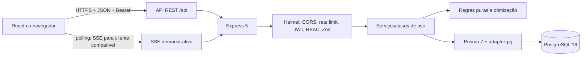
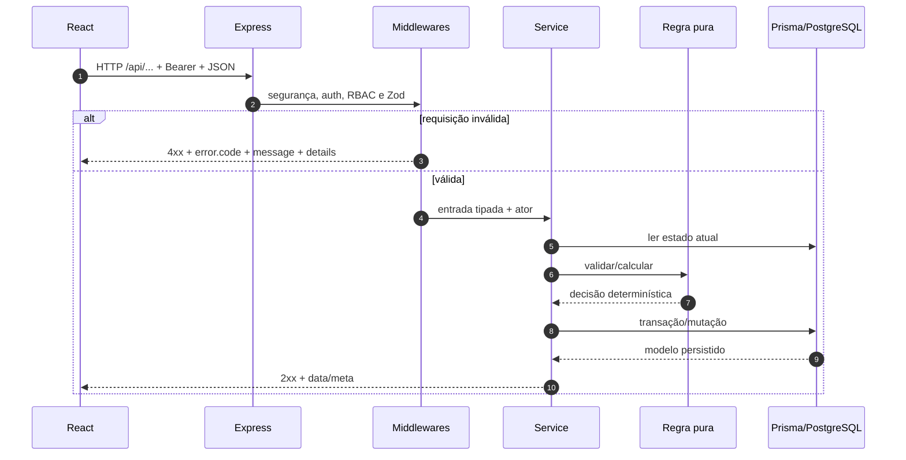
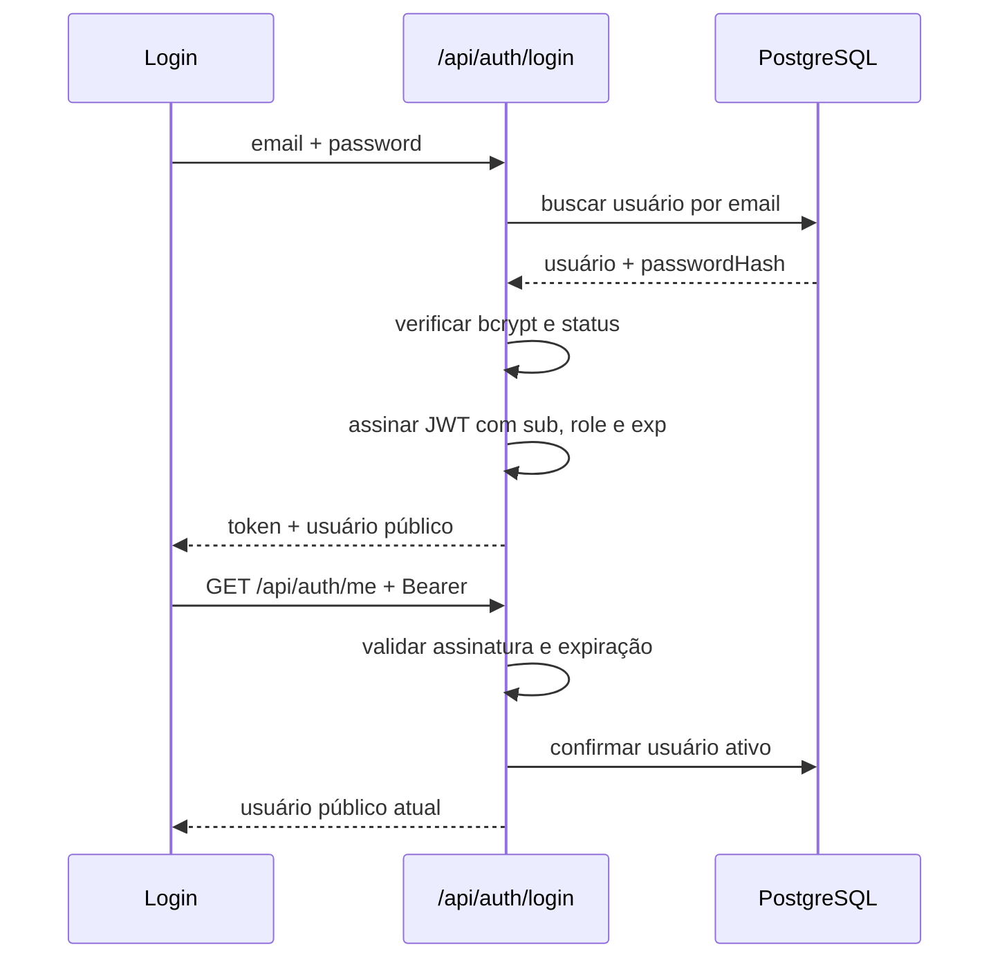
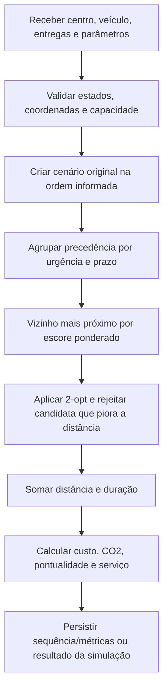

# Arquitetura - UrbanLink Flow

> Este documento veio do projeto anterior em 16/11/2026. O que ele diz sobre o back-end e o banco vale pra pasta `backend/` deste repositório. O que ele diz sobre o front (pasta `frontend/`, Leaflet, cidade 3D) descreve o front antigo, que não está aqui.

## 1. Visão geral

O UrbanLink Flow é um monólito modular full-stack organizado como monorepo npm:

```text
/
|-- frontend/                 React + TypeScript + Vite
|   `-- src/
|       |-- components/       shell, UI, tabelas, mapa e 3D
|       |-- contexts/         sessão e feedback transversal
|       |-- pages/            rotas de tela e formulários
|       |-- services/         cliente HTTP
|       |-- types/            contratos do cliente
|       `-- utils/            formatação
|-- backend/                  Express + TypeScript + Prisma
|   |-- prisma/               schema, migrations e seed
|   `-- src/
|       |-- config/           ambiente
|       |-- docs/             documento OpenAPI
|       |-- lib/              cliente Prisma
|       |-- middleware/       segurança, auth, RBAC, validação e erros
|       |-- modules/          rotas, schemas e serviços por domínio
|       |-- services/         regras e algoritmos compartilhados
|       |-- shared/           respostas, erros e schemas comuns
|       `-- types/            extensões de tipos
|-- docs/
|-- docker-compose.yml
`-- package.json              comandos agregados e workspaces
```

A escolha é deliberadamente pragmática: um serviço HTTP e um banco são
suficientes para o volume escolar/demonstrativo, simplificam execução e ainda
preservam limites claros de domínio.



## 2. Componentes

### 2.1 Front-end

| Componente                      | Responsabilidade                                                     |
| ------------------------------- | -------------------------------------------------------------------- |
| React + React Router            | páginas, layouts, rotas protegidas e rota não encontrada             |
| TanStack Query                  | cache de servidor, loading/error, invalidação após mutação e refetch |
| React Hook Form + Zod           | estado e validação dos formulários                                   |
| Cliente da API                  | base URL, JWT, envelope, erro padronizado e cancelamento             |
| Leaflet + OpenStreetMap         | mapa operacional sem chave paga                                      |
| Recharts                        | KPIs, séries e distribuições retornadas pela API                     |
| React Three Fiber/Three.js/Drei | cidade abstrata, lazy e com fallback                                 |
| CSS/Tailwind equivalente        | design responsivo, tokens e acessibilidade                           |

Rotas de tela:

| Caminho       | Página                   | Acesso                          |
| ------------- | ------------------------ | ------------------------------- |
| `/login`      | Login                    | público                         |
| `/`           | Dashboard                | autenticado                     |
| `/mapa`       | Mapa operacional         | autenticado                     |
| `/entregas`   | Entregas                 | autenticado; escrita por perfil |
| `/veiculos`   | Veículos                 | autenticado; escrita por perfil |
| `/rotas`      | Rotas                    | autenticado; escrita por perfil |
| `/simulacoes` | Simulações               | `ADMIN`, `MANAGER`              |
| `/relatorios` | Indicadores e relatórios | `ADMIN`, `MANAGER`              |
| `/usuarios`   | Usuários                 | `ADMIN`                         |
| `*`           | Não encontrada           | público                         |

Estado de servidor permanece no TanStack Query. Estado global é reservado à
sessão e preferências de UI; listas e indicadores não são duplicados em stores.

### 2.2 Back-end

O back-end é dividido por responsabilidade e por domínio:

| Módulo                 | Casos de uso                                     |
| ---------------------- | ------------------------------------------------ |
| `auth`                 | login e sessão atual                             |
| `users`                | gestão administrativa                            |
| `vehicles`             | frota, disponibilidade e posição                 |
| `distribution-centers` | origens logísticas                               |
| `deliveries`           | cadastro, atribuição e estados                   |
| `routes`               | paradas, cálculo, otimização, início e conclusão |
| `simulations`          | cenários e resultados persistidos                |
| `dashboard`            | resumo, séries, mapa, cidade e stream            |
| `reports`              | consolidados operacionais e desempenho           |
| `health`               | processo, banco e horário                        |

Os handlers de rota fazem a adaptação HTTP e delegam aos services; não decidem as
regras centrais. Os services coordenam transações, consultas Prisma e entidades.
Não há uma camada `repository` pass-through: para este porte, o acesso Prisma fica
no service do domínio. Funções de distância, duração, custo, CO2, ordenação e
transições são puras sempre que possível.

### 2.3 Persistência

Prisma fornece acesso tipado ao PostgreSQL. As 10 entidades e as decisões físicas
estão em [MODELO_DADOS.md](./MODELO_DADOS.md). Migrations são versionadas; o seed
gera um cenário brasileiro coerente e credenciais somente locais.

Operações que alteram mais de uma entidade usam transação:

- atribuição de entregas e validação de capacidade;
- criação/reordenação de paradas;
- início, conclusão e cancelamento de rota;
- execução e persistência de simulação.

As verificações concorrentes de carga/disponibilidade na atribuição de entrega e
na criação de rota usam isolamento `Serializable`. Um conflito de serialização é
devolvido ao cliente; esta versão não faz retry automático.

## 3. Fluxo de uma requisição



Ordem dos middlewares:

1. geração/eco de `X-Request-Id`;
2. Helmet;
3. CORS;
4. parser JSON com limite;
5. rate limit global e limitador mais estrito em login;
6. autenticação e RBAC por rota;
7. validação Zod;
8. handler/controller;
9. not-found e error handler central.

### Contrato de resposta

Sucesso:

```json
{
  "success": true,
  "data": {},
  "meta": {
    "page": 1,
    "pageSize": 20,
    "total": 42,
    "totalPages": 3
  }
}
```

Erro:

```json
{
  "success": false,
  "error": {
    "code": "VALIDATION_ERROR",
    "message": "Dados inválidos.",
    "details": []
  }
}
```

`meta` é omitido fora de coleções paginadas. O servidor não envia stack trace em
produção.

## 4. Autenticação e autorização



Decisões:

- o JWT chega em `Authorization: Bearer <token>`;
- o segredo e a expiração vêm do ambiente;
- a senha nunca sai da camada de autenticação;
- o middleware reconfirma identidade/status em rotas protegidas;
- `role` do token não substitui a autorização com estado atual quando a ação é
  sensível;
- CORS aceita somente a origem configurada;
- o login possui rate limit próprio;
- o front-end limpa a sessão em `401` e preserva a rota de retorno quando seguro.

Para produção, HTTPS é obrigatório. Se o cliente persistir JWT em armazenamento
Web, o risco de XSS deve ser tratado com política de conteúdo e dependências
auditadas; uma evolução possível é sessão por cookie `HttpOnly`, `Secure` e
`SameSite`.

## 5. Otimização de rota

O motor é local, explicável e independente de API paga.



Para simulações com vários veículos, as entregas são primeiro agrupadas pelo
centro de origem e distribuídas deterministicamente entre até
`availableVehicles` rotas. Cada rota respeita `capacityKgPerVehicle`; distância,
duração, custo e emissão são somados, enquanto o tempo total operacional
(`makespan`) é o maior tempo entre as rotas paralelas. Entregas sem veículo ou
capacidade ficam identificadas em `routeData.unassignedDeliveries`.

### Fórmulas

```text
distância = soma das pernas calculadas por Haversine

duração =
  (distância / velocidade média) * 60 * fator de tráfego
  + número de paradas * atendimento médio

combustível = distância / eficiência em km por litro
custo = combustível * preço por litro
CO2 = combustível * fator de emissão
```

`fuelConsumption` e `fuelConsumptionKmPerLiter` usam quilômetros por litro
(`km/l`). O cálculo de combustível fica centralizado para que essa unidade não seja
misturada com litros/100 km.

Determinismo:

- mesmo conjunto, parâmetros e instante de referência produzem a mesma ordem;
- empates usam prioridade, prazo e ID/código estável;
- 2-opt só substitui a solução quando a distância não aumenta;
- prioridade e prazo influenciam o escore, mas não são janelas de tempo rígidas;
- o resultado informa que a distância é geodésica aproximada, não viária;
- nenhuma mensagem usa “IA” ou “ótimo global”.

## 6. Server-Sent Events e telemetria demonstrativa

SSE foi escolhido porque o fluxo necessário é servidor -> navegador, com
reconexão simples e custo menor que WebSocket para uma demo local.

Endpoint: `GET /api/dashboard/live`.

O evento implementado é `snapshot`. A cada 2 segundos ele contém `mode`,
`tick`, `generatedAt` e a lista de veículos interpolados; a conexão é encerrada
depois de 61 ticks para limitar recursos da demonstração. O último snapshot
representa 100% do percurso.

O dashboard web atual usa polling pausável a cada 30 segundos e mantém o rótulo
“Modo de demonstração”. O SSE pode ser exercitado por `curl`/cliente compatível e
é uma opção de evolução para dirigir a animação da UI.

Regras:

- toda mensagem inclui `mode: "DEMO"`, contador determinístico e horário de
  geração;
- posições são interpoladas sobre os pontos persistidos de uma rota ativa;
- um contador/seed estável substitui aleatoriedade irreproduzível;
- o stream não altera estados de negócio; mutações usam endpoints REST explícitos;
- o cliente fecha a conexão ao sair/logout;
- o encerramento limitado evita conexões de demonstração indefinidas;
- após encerramento/reconexão, o cliente invalida/refaz as consultas REST;
- UI exibe “Modo de demonstração” e horário da última atualização.

Quando o cliente precisa enviar Bearer, ele pode consumir o stream com `fetch` e
`ReadableStream`. Evita-se colocar JWT na query string, pois URLs podem aparecer
em histórico e logs. Se a implementação usar `EventSource` nativo, o stream deve
ser público e estritamente demonstrativo ou usar um ticket efêmero de uso único.

Fallback: polling controlado do resumo/mapa, com pausa em aba oculta e backoff em
falhas. A ausência de SSE não bloqueia CRUDs ou navegação.

## 7. Mapa e cidade 3D

Ambos consomem projeções de leitura específicas, evitando que o navegador tenha de
juntar tabelas:

- `GET /api/dashboard/map`: centros, veículos, entregas, paradas e polylines;
- `GET /api/dashboard/city`: objetos simplificados e métricas da cena;
- `GET /api/dashboard/summary`: KPIs;
- `GET /api/dashboard/timeseries`: séries de gráficos.

O mapa usa coordenadas reais do seed e linhas retas entre pontos; isso é declarado
na interface. Tiles do OpenStreetMap dependem da internet e devem preservar a
atribuição obrigatória.

A cidade 3D:

- é carregada por `lazy`/`Suspense`;
- usa geometrias simples e quantidade limitada de objetos;
- converte latitude/longitude para coordenadas locais em uma função única;
- não é a fonte de verdade de estados;
- reduz ou pausa movimento conforme preferência;
- oferece fallback 2D se WebGL estiver indisponível;
- não bloqueia os KPIs nem o restante do dashboard.

## 8. Observabilidade e erros

Para uma demonstração verificável:

- `/api/health` diferencia processo ativo e acesso ao banco;
- e-mail completo, senha, hash, token e segredos não são logados;
- erros usam códigos estáveis (`VALIDATION_ERROR`, `UNAUTHORIZED`,
  `FORBIDDEN`, `NOT_FOUND`, `CONFLICT`, `BUSINESS_RULE_VIOLATION`,
  `RATE_LIMITED`, `INTERNAL_ERROR`);
- `AuditLog` registra mutações sensíveis;
- `Alert` representa ocorrência de domínio, não exceção técnica;
- timestamps são armazenados em UTC e formatados no cliente.

A API gera ou ecoa `X-Request-Id` em cada resposta. A versão atual registra erros
inesperados no processo, mas ainda não associa esse ID a logs estruturados nem
exporta telemetria para uma plataforma de observabilidade. Isso é uma limitação
explícita, não um recurso simulado.

## 9. Estratégia de testes

### Unidade

- Haversine com distância zero e pontos conhecidos;
- fatores de tráfego e tempo de atendimento;
- custo/CO2 e proteção contra divisões inválidas;
- capacidade exata, abaixo e acima do limite;
- matriz de transições de entrega/rota/parada;
- vizinho mais próximo, desempate e 2-opt;
- indicadores e percentual de melhoria.

### Integração da API

- login válido/inválido e rate limit;
- autenticação, RBAC e ausência de hash;
- CRUD, filtros, paginação, conflito de unicidade;
- transações de atribuição/início/conclusão;
- execução e leitura de simulação;
- reconciliação do dashboard;
- health e contrato OpenAPI;
- stream SSE encerra corretamente.

### Front-end e fluxo

- rotas públicas/protegidas;
- validação de formulários;
- loading, erro, vazio e retry;
- filtro/paginação e invalidação de cache;
- mapa e 3D com fallback;
- jornada demo: login -> atribuir -> otimizar -> iniciar -> acompanhar -> concluir
  -> executar simulação -> comparar indicadores.

### Cobertura entregue e lacunas

Os testes automatizados entregues cobrem:

- Haversine, duração, soma de trechos, capacidade e transições;
- vizinho mais próximo, 2-opt e comparação de distância;
- exclusividade de entregas, carga acumulada, ciclo e idempotência de rotas;
- simulação multiveículo, capacidade individual, múltiplos centros e projeção 3D;
- métricas de dashboard/relatórios e períodos baseados nos eventos reais;
- login com repositório simulado, senha inválida e usuário inativo;
- liveness, proteção, validação, not-found e contrato OpenAPI via Supertest;
- login, rota protegida, filtros, multiselect, fuso horário e erro/retry de componentes;
- smoke HTTP integrado com CRUD, RBAC, simulação e invariantes contra PostgreSQL.

Não há nesta versão uma suíte Playwright versionada nem banco efêmero criado
automaticamente por teste. A interface foi verificada com Playwright headless em
desktop e mobile, e o smoke usa o PostgreSQL local preparado para a demonstração.

## 10. Decisões arquiteturais

| Decisão                    | Justificativa                                        | Consequência                                           |
| -------------------------- | ---------------------------------------------------- | ------------------------------------------------------ |
| Monólito modular           | escopo e operação local não justificam microserviços | deploy simples; limites internos devem ser preservados |
| Prisma direto no service   | evita repository que apenas repetiria a API do ORM   | services não devem misturar adaptação HTTP             |
| npm workspaces             | scripts agregados sem ferramenta extra               | dependências continuam separadas por workspace         |
| PostgreSQL + Prisma        | integridade relacional, migrations e tipagem         | banco precisa estar disponível no runtime              |
| REST + SSE                 | CRUD síncrono e atualização unidirecional            | SSE é demo e requer estratégia de reconexão            |
| Zod nas bordas             | um contrato explícito antes do domínio               | validação não substitui regras agregadas               |
| Heurística NN + 2-opt      | explicável, determinística e suficiente para TCC     | não garante ótimo nem trajeto viário                   |
| OpenStreetMap/Leaflet      | sem chave ou serviço pago obrigatório                | tiles exigem internet e atribuição                     |
| JSON apenas para snapshots | flexibilidade sem abandonar relações                 | formato precisa de validação/versionamento             |
| 3D progressivo             | valor visual funcional sem bloquear o produto        | precisa de fallback e limite de objetos                |

## 11. Limites e evolução

Limites intencionais desta versão:

- cálculo geodésico, sem trânsito/GPS/roteamento viário real;
- SSE demonstrativo, não rastreamento de frota;
- uma instância de API e sem fila de jobs;
- autenticação JWT local, sem recuperação de senha, MFA ou provedor externo;
- seed de uma cidade e volume pequeno;
- métricas monetárias em ponto flutuante no schema atual;
- sem retry automático para conflito de transação serializável;
- auditoria gravada após a mutação, sem atomicidade conjunta nesta versão.

Evoluções naturais seriam PostGIS, motor viário (OSRM), filas para otimizações
longas, refresh token/cookies seguros, telemetria real, decimal monetário e
isolamento multiempresa. Elas não são necessárias para demonstrar os requisitos
do projeto atual.
