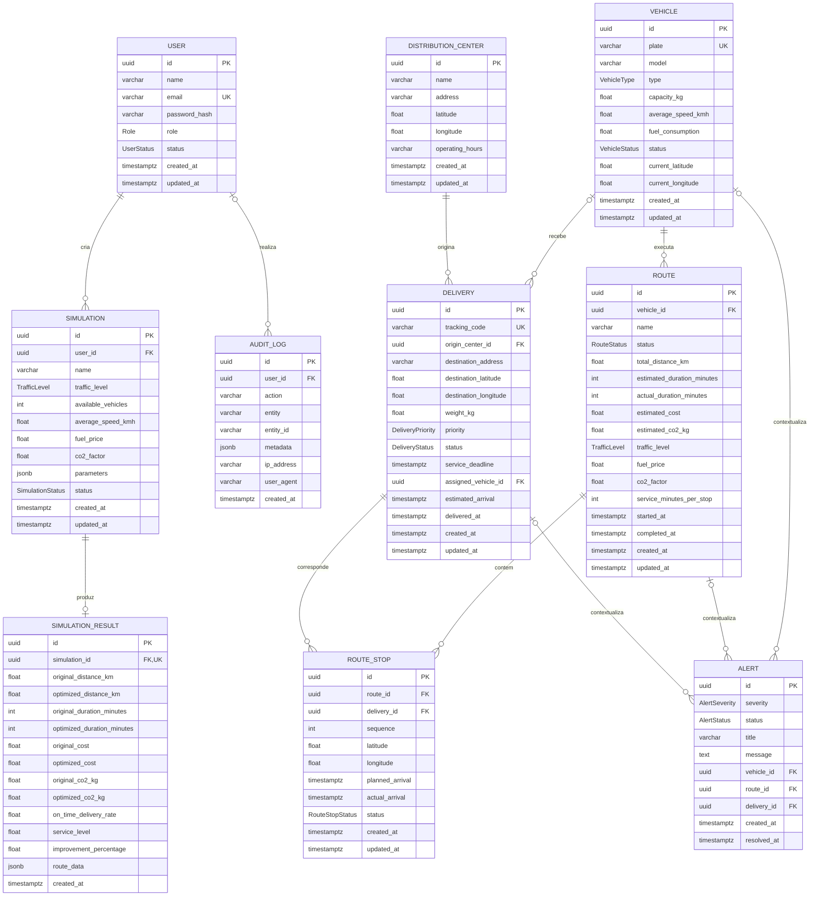

# Modelo de Dados - UrbanLink Flow

## 1. Visão geral

O modelo usa PostgreSQL e Prisma ORM. Ele separa cadastro, operação, simulação,
alerta e auditoria em 10 entidades relacionais. Os identificadores são UUID, datas
operacionais usam fuso (`timestamptz`) e os nomes físicos seguem `snake_case`.

Entidades obrigatórias do domínio:

1. `User`
2. `Vehicle`
3. `DistributionCenter`
4. `Delivery`
5. `Route`
6. `RouteStop`
7. `Simulation`
8. `SimulationResult`

Entidades complementares:

9. `Alert`
10. `AuditLog`

## 2. Modelo conceitual

- Um **usuário** possui perfil e pode criar várias **simulações**.
- Um **veículo** pode receber várias **entregas** e executar várias **rotas** ao
  longo do tempo.
- Um **centro de distribuição** origina várias **entregas**.
- Uma **rota** pertence a um veículo e contém uma sequência de **paradas**.
- Uma **parada** liga uma rota a uma entrega e registra planejamento e execução.
- Uma **simulação** possui no máximo um **resultado** consolidado.
- Um **alerta** pode contextualizar um veículo, uma rota, uma entrega ou uma
  combinação coerente deles.
- Um **registro de auditoria** pode apontar para o usuário responsável e identifica
  a entidade afetada sem acoplamento por chave estrangeira polimórfica.

### DER



`o|` indica relacionamento opcional; por isso uma entrega pode ainda não possuir
veículo e um alerta pode se referir apenas a um dos agregados operacionais.

## 3. Modelo lógico

### 3.1 Identidade e segurança

#### `users`

| Atributo                   | Tipo lógico | Obrigatório | Regra                              |
| -------------------------- | ----------- | ----------: | ---------------------------------- |
| `id`                       | UUID        |         sim | PK                                 |
| `name`                     | texto(120)  |         sim | nome legível                       |
| `email`                    | texto(255)  |         sim | único; normalizado para comparação |
| `password_hash`            | texto(255)  |         sim | hash bcrypt; nunca exposto         |
| `role`                     | enum        |         sim | `ADMIN`, `MANAGER`, `OPERATOR`     |
| `status`                   | enum        |         sim | `ACTIVE`, `INACTIVE`, `SUSPENDED`  |
| `created_at`, `updated_at` | instante    |         sim | auditoria                          |

#### `audit_logs`

Registra `action`, `entity`, `entity_id`, metadados seguros, IP, user-agent e
instante. `user_id` é opcional para preservar eventos de sistema ou de usuário
posteriormente removido.

### 3.2 Frota e distribuição

#### `vehicles`

Identificado por placa única. Capacidade, velocidade e consumo em quilômetros por
litro (`km/l`) devem ser maiores que zero na validação do domínio. Coordenadas
atuais são opcionais e devem formar um par válido quando presentes.

Enums:

- tipo: `MOTORCYCLE`, `VAN`, `TRUCK`, `BICYCLE`;
- estado: `AVAILABLE`, `IN_ROUTE`, `MAINTENANCE`, `INACTIVE`.

#### `distribution_centers`

Contém nome, endereço, latitude, longitude e horário operacional. A referência de
uma entrega ao centro é obrigatória.

#### `deliveries`

`tracking_code` é único. A entrega pertence a um centro e pode estar atribuída a
um veículo. Peso, destino, prioridade, prazo e estado alimentam capacidade,
otimização, mapa e indicadores.

Enums:

- prioridade: `LOW`, `NORMAL`, `HIGH`, `URGENT`;
- estado: `PENDING`, `ASSIGNED`, `IN_TRANSIT`, `DELIVERED`, `FAILED`,
  `CANCELED`.

### 3.3 Rotas

#### `routes`

Agregado operacional vinculado obrigatoriamente a um veículo. Armazena métricas,
instantes reais de início/fim e as premissas de tráfego, combustível, emissão e
atendimento usadas no cálculo. Persistir essas premissas evita que uma
reotimização altere silenciosamente o cenário original.

Estado: `PLANNED`, `ACTIVE`, `COMPLETED`, `CANCELED`.

#### `route_stops`

Entidade associativa entre rota e entrega com atributos próprios. A sequência e a
entrega são únicas dentro da mesma rota:

```text
UNIQUE(route_id, sequence)
UNIQUE(route_id, delivery_id)
```

Estado: `PENDING`, `ARRIVED`, `COMPLETED`, `SKIPPED`, `FAILED`.

### 3.4 Simulações

#### `simulations`

Pertence ao usuário que criou o cenário. Os parâmetros consultados frequentemente
ficam em colunas tipadas; seleção de entregas e opções extensíveis ficam no JSON
`parameters`.

Estado: `DRAFT`, `RUNNING`, `COMPLETED`, `FAILED`.

#### `simulation_results`

Relação 1:0..1 garantida por `simulation_id` único. Preserva o comparativo
original/otimizado e um snapshot JSON de pontos e sequências em `route_data`.

### 3.5 Monitoramento

#### `alerts`

Registra severidade (`INFO`, `WARNING`, `CRITICAL`), estado (`OPEN`,
`ACKNOWLEDGED`, `RESOLVED`), título, mensagem e referências opcionais a veículo,
rota e entrega.

## 4. Modelo físico

O arquivo executável do modelo é `backend/prisma/schema.prisma`; migrations ficam
em `backend/prisma/migrations/`.

### Tipos e convenções

| Conceito                  | PostgreSQL/Prisma                     |
| ------------------------- | ------------------------------------- |
| ID                        | `uuid` com `uuid()`                   |
| Data/hora                 | `timestamptz(3)`                      |
| Enum                      | enum nativo gerenciado pela migration |
| Texto limitado            | `varchar(n)`                          |
| Texto livre               | `text`                                |
| Flexibilidade controlada  | `jsonb`                               |
| Medidas e métricas atuais | `double precision` por `Float`        |

Os valores monetários estão representados por `Float` no schema atual por
simplicidade didática. Em um produto financeiro, a evolução recomendada é
`decimal(p,s)` ou valores inteiros em centavos para evitar arredondamento binário.

### Chaves e relacionamentos

| Origem                             | Destino                   | Cardinalidade   | Exclusão   |
| ---------------------------------- | ------------------------- | --------------- | ---------- |
| `deliveries.origin_center_id`      | `distribution_centers.id` | N:1 obrigatória | `RESTRICT` |
| `deliveries.assigned_vehicle_id`   | `vehicles.id`             | N:1 opcional    | `SET NULL` |
| `routes.vehicle_id`                | `vehicles.id`             | N:1 obrigatória | `RESTRICT` |
| `route_stops.route_id`             | `routes.id`               | N:1 obrigatória | `CASCADE`  |
| `route_stops.delivery_id`          | `deliveries.id`           | N:1 obrigatória | `RESTRICT` |
| `simulations.user_id`              | `users.id`                | N:1 obrigatória | `RESTRICT` |
| `simulation_results.simulation_id` | `simulations.id`          | 1:1             | `CASCADE`  |
| `alerts.vehicle_id`                | `vehicles.id`             | N:1 opcional    | `CASCADE`  |
| `alerts.route_id`                  | `routes.id`               | N:1 opcional    | `CASCADE`  |
| `alerts.delivery_id`               | `deliveries.id`           | N:1 opcional    | `CASCADE`  |
| `audit_logs.user_id`               | `users.id`                | N:1 opcional    | `SET NULL` |

### Índices

Além das PKs e unicidades, o schema indexa:

- usuário por `(role, status)`;
- veículo por `status` e `type`;
- centro por `name`;
- entrega por `(status, priority)`, centro, veículo e prazo;
- rota por `(vehicle_id, status)` e `status`;
- parada por entrega e estado;
- simulação por `(user_id, status)` e criação;
- resultado por criação;
- alerta por `(status, severity)` e cada referência;
- auditoria por `(user_id, created_at)`, `(entity, entity_id)` e ação.

Esses índices cobrem filtros de telas, dashboard, autorização e investigação. O
plano de consulta deve ser revisto com volume real antes de adicionar índices.

### Restrições de domínio

Prisma e PostgreSQL garantem estrutura, FK e unicidade. Regras que dependem de
estado agregado são aplicadas pelo serviço transacional:

- capacidade do veículo;
- pares válidos de latitude/longitude;
- valores positivos;
- transições de estado;
- terminalidade de rota/entrega;
- conclusão de todas as paradas;
- coerência entre entrega, parada, rota e veículo.

## 5. Normalização

### Primeira forma normal (1FN)

- colunas escalares possuem domínio definido;
- entregas e paradas não são listas em uma coluna da rota;
- papéis, estados e prioridades usam enums estáveis;
- endereços e coordenadas são atributos atômicos necessários ao caso de uso.

### Segunda forma normal (2FN)

- atributos de `RouteStop` dependem da identidade da associação rota-entrega;
- métricas de rota dependem de `Route`, não são repetidas em cada parada;
- dados do veículo e centro não são copiados para entrega.

### Terceira forma normal (3FN)

- usuário, veículo, centro, entrega e rota possuem fontes únicas de verdade;
- `RouteStop` resolve a relação N:N histórica entre rota e entrega;
- `SimulationResult` separa entrada de cenário e saída calculada;
- dados de auditoria e alerta não contaminam entidades operacionais.

### JSON deliberado

`Simulation.parameters`, `SimulationResult.route_data` e `AuditLog.metadata` usam
JSON porque são snapshots extensíveis e não a fonte primária dos cadastros.
Critérios:

- campos usados em filtro, relacionamento ou integridade permanecem tipados;
- IDs em snapshots não substituem FKs operacionais;
- payloads JSON são validados por Zod antes da persistência;
- alterações de formato devem manter compatibilidade ou versão explícita.

Assim, o uso de JSON é uma desnormalização controlada para reprodutibilidade e
auditoria, não uma substituição do modelo relacional.

## 6. Integridade, concorrência e auditoria

- atribuição e criação de rota usam transação `Serializable`, recalculando
  capacidade/disponibilidade antes da escrita;
- início/conclusão de rota e execução de simulação usam transações para suas
  mutações coordenadas;
- exclusões que quebrariam histórico são rejeitadas ou substituídas por estado
  inativo;
- erros de unicidade são convertidos para `409 Conflict`;
- operações sensíveis geram `AuditLog`;
- `password_hash`, JWT e segredos nunca entram em metadados de auditoria;
- migrations são a única forma suportada de evoluir o schema compartilhado.

Não há retry automático em falha de serialização; o cliente pode tentar novamente
uma operação idempotente após receber o erro.

## 7. Dados de demonstração

O seed deve criar, em uma única cidade brasileira e com coordenadas coerentes:

- 3 usuários (`ADMIN`, `MANAGER`, `OPERATOR`);
- 2 centros de distribuição;
- pelo menos 8 veículos;
- pelo menos 20 entregas em estados variados;
- rotas planejadas, ativas e concluídas;
- simulações concluídas;
- entregas concluídas e atrasadas;
- alertas suficientes para demonstrar monitoramento.

O seed deve ser idempotente para o ambiente local ou documentar claramente quando
requer banco limpo.

## Solicitações do site institucional

A tabela `inquiries` registra as mensagens enviadas pelo formulário público. Ela possui `id` UUID, `name` (120 caracteres), `email` (255), `company` (160, opcional), `phone` (30, opcional), `subject` (80), `message` (3000) e `created_at` com fuso horário. Há um índice em `created_at` para a listagem das solicitações mais recentes.

A criação exige consentimento no payload. A resposta pública contém somente identificador e data; a consulta dos dados completos exige perfil `ADMIN` ou `MANAGER`. A migration aditiva é `20261020235500_add_inquiries`. Nenhuma tabela operacional foi removida.
