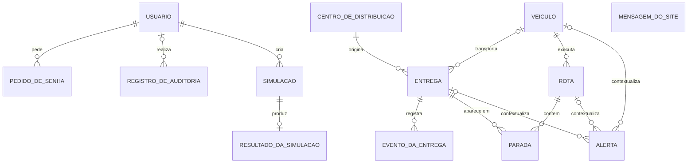

# Modelagem conceitual

Quais coisas o sistema guarda e como elas se relacionam, sem tipos nem colunas. A modelagem lógica ([modelagem-logica.md](modelagem-logica.md)) detalha cada uma.

## Entidades

| Entidade | O que representa | Tabela |
| --- | --- | --- |
| Usuário | Pessoa que entra na plataforma, com perfil ADMIN, MANAGER ou OPERATOR. | `users` |
| Pedido de senha nova | Link de senha nova: guarda só o hash do token, vale uma vez e até vencer. | `password_reset_tokens` |
| Registro de auditoria | Quem fez o quê e quando (login, mudanças de estado, cadastros). | `audit_logs` |
| Veículo | Veículo da frota, com capacidade, velocidade média, consumo e posição. | `vehicles` |
| Centro de distribuição | Galpão de onde as entregas saem. | `distribution_centers` |
| Entrega | Pedido a entregar, com código de rastreio, destino, peso, prioridade, prazo e estado. | `deliveries` |
| Evento da entrega | Histórico de estados da entrega, gravado pelo trigger deliveries_record_event. | `delivery_events` |
| Rota | Percurso de um veículo, com distância, duração, custo e CO2 estimados. | `routes` |
| Parada | Uma entrega dentro de uma rota, na ordem da visita. | `route_stops` |
| Simulação | Cenário de teste: tráfego, frota, combustível e entregas escolhidas. | `simulations` |
| Resultado da simulação | Comparação entre a ordem original e a otimizada. | `simulation_results` |
| Alerta | Aviso operacional ligado a um veículo, uma rota ou uma entrega. | `alerts` |
| Mensagem do site | Mensagem do Fale com a gente, com protocolo gerado pelo banco. | `inquiries` |

## Relacionamentos

| Entidade | Relacionamento | Entidade | Cardinalidade |
| --- | --- | --- | --- |
| Usuário | pede | Pedido de senha nova | 1 : 0..N |
| Usuário | realiza | Registro de auditoria | 0..1 : 0..N |
| Veículo | transporta | Entrega | 0..1 : 0..N |
| Centro de distribuição | origina | Entrega | 1 : 0..N |
| Entrega | registra | Evento da entrega | 1 : 0..N |
| Veículo | executa | Rota | 1 : 0..N |
| Entrega | aparece em | Parada | 1 : 0..N |
| Rota | contem | Parada | 1 : 0..N |
| Usuário | cria | Simulação | 1 : 0..N |
| Simulação | produz | Resultado da simulação | 1 : 0..1 |
| Entrega | contextualiza | Alerta | 0..1 : 0..N |
| Rota | contextualiza | Alerta | 0..1 : 0..N |
| Veículo | contextualiza | Alerta | 0..1 : 0..N |

Cardinalidade: `1 : 0..N` é um pra zero ou muitos; `0..1` do lado esquerdo quer dizer que o vínculo é opcional (uma entrega pode ainda não ter veículo, um alerta pode não ter rota). A mensagem do site não se liga a nenhuma outra entidade.

Regras do domínio que o modelo sustenta:

- Uma entrega sai de um centro de distribuição e pode ser atribuída a um veículo, sem passar da capacidade dele.
- Uma rota pertence a um veículo e visita as entregas pela ordem das paradas; a mesma entrega não se repete na rota, e duas paradas não têm a mesma posição.
- Cada mudança de estado de uma entrega vira um evento do histórico, que o rastreio público mostra.
- Uma simulação é criada por um usuário e tem no máximo um resultado.

## Diagrama conceitual

